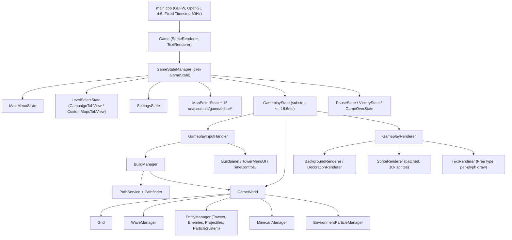

# Аудит проекта Tower Defense (C++ / OpenGL)

> **Дата аудита:** 2026-11-23  
> **Объём кодовой базы:** 142 исходных файла в `src/`, **32 500 строк** (без учёта `external/`). Автотестов: **0**.  
> **Технологический стек:** C++17, OpenGL 4.6 Core Profile (текст-шейдеры на `#version 330 core`), GLFW, GLAD, GLM, FreeType, `miniaudio`, `nlohmann/json`, `stb_image`, CMake 3.28+.

---

## 1. Текущее состояние проекта

### 1.1. Метрики по модулям

| Модуль | Файлы | Строки | Доля | Комментарий |
| :--- | ---: | ---: | ---: | :--- |
| `src/game/editor` | 30 | 9 167 | 28.2% | 15 вынесенных модалок, инспекторов и контроллеров редактора |
| `src/game/states` | 21 | 7 481 | 23.0% | Включает `MapEditorState.{h,cpp}` (**4 726 строк**) |
| `src/game/core` | 22 | 3 701 | 11.4% | `LevelManager` (1 179), `LocalizationManager`, `CampaignManager`, `WaveManager`, `ConfigManager`, `SaveManager`, `SettingsManager`, `EventBus`, `InputManager`, `Game` |
| `src/renderer` | 10 | 3 235 | 10.0% | `BackgroundRenderer` (1 048), `DecorationRenderer` (907), `GameplayRenderer`, `SpriteRenderer`, `TextRenderer` |
| `src/game/ui` | 19 | 2 508 | 7.7% | `BuildPanel`, `TowerMenuUI`, `PlacementUI`, `PathRenderer`, `VolumeSliderWidget`, `CampaignTabView`, `CustomMapsTabView`, `UICommon.h` |
| `src/game/world` | 10 | 2 376 | 7.3% | `Grid`, `Pathfinder`, `PathService`, `GameWorld`, `MinecartManager` |
| `src/game/entities` | 9 | 2 139 | 6.6% | `Enemy` (974), `Tower`, `Projectile`, `TowerTargetingSystem`, `CircleCollider` |
| `src/particles` | 4 | 777 | 2.4% | `EnvironmentParticleManager`, `ParticleSystem` |
| `src/game/gameplay` | 5 | 339 | 1.0% | `EntityManager`, `BuildManager`, `PlayerStats` |
| `src/audio` | 4 | 247 | 0.8% | `AudioManager` (`miniaudio`), `AudioEventSystem` |
| `root` / `shaders` / `textures` / `resources` | 8 | 530 | 1.6% | `main.cpp`, `stb_image.cpp`, `ResourceManager`, `ShaderProgram`, `Texture2D` |
| **ИТОГО** | **142** | **32 500** | **100%** | **Редактор карт (`game/editor` + `MapEditorState`) = 13 893 строки (42.7% всего проекта)** |

**Топ-10 самых крупных `.cpp` файлов:**
1. `src/game/states/MapEditorState.cpp` — **4 429 строк**
2. `src/game/editor/EditorWaveModal.cpp` — **1 413 строк**
3. `src/game/core/LevelManager.cpp` — **1 179 строк**
4. `src/game/editor/EditorLevelSettingsModal.cpp` — **1 111 строк**
5. `src/game/editor/EditorToolbarUI.cpp` — **1 091 строка**
6. `src/renderer/BackgroundRenderer.cpp` — **1 048 строк**
7. `src/game/entities/Enemy.cpp` — **974 строки**
8. `src/renderer/DecorationRenderer.cpp` — **907 строк**
9. `src/game/editor/EditorMapsBrowserModal.cpp` — **842 строки**
10. `src/game/ui/level_select/CustomMapsTabView.cpp` — **639 строк**

### 1.2. Что уже готово и работает

- **Игровой цикл и управление временем:** фиксированный тик `FIXED_DT = 1/60s` в `src/main.cpp` + субстеппинг по `0.0166667s` в `GameplayState::update` при ускорении `1x / 2x / 4x` (`Tab` / кнопки HUD) и тактическая пауза (`P`).
- **Состояния игры:** `MainMenuState`, `LevelSelectState` (разбит на `CampaignTabView` и `CustomMapsTabView`), `GameplayState` (декомпозирован на `GameWorld`, `GameplayInputHandler`, `GameplayRenderer`), `PauseState`, `SettingsState`, `VictoryState`, `GameOverState`, `MapEditorState`.
- **Башни (`res/configs/towers.json`):**
  - `Basic` (3 уровня, обычная стрельба + самонаводящиеся снаряды со swept CCD);
  - `Mercury` (3 уровня, splash + статус-эффекты `Slow` и `Poison`);
  - `Piston` (3 уровня, 4 фиксированных направления, поворот по `R`, отталкивание на 1 / 1.3 клетки, оглушение при ударе о стену на `0.8s`, сброс в шурф `Chasm` с анимацией падения и instakill, T3 шипы с уроном + `Bleed` + `Vulnerable`).
- **Враги (`res/configs/enemies.json`):** `Coal` (процедурная пульсация прожилок), `Spark` (быстрый враг с анимацией пламени), линейка сплит-врагов `Mercury_Large → Mercury_Medium → Mercury_Small` (наследуют маршрут и текущий вейпоинт родителя), а также скрытые прототипы `Basic`, `Fast`, `Tank`.
- **Мир и поиск путей:**
  - `Grid`: типы клеток `Ground`, `Path`, `Platform`, `Scenery`, `Chasm`, `Rail`, `Tower`, `Spawner`, `Base`, `Empty`, маска запрета строительства `noBuildMask`, внешние клетки `outerCells` и боковые карманы `sidePockets`.
  - `Pathfinder`: обратная `DijkstraMap` (Flow Field) + многоцелевой A* с плоским массивом узлов и epoch-сбросом + запрет диагонального срезания углов.
  - `PathService`: расчёт маршрутов всех спавнеров и проверка валидности постройки башни (не перекрывает спавнеры, базы, живых врагов и не запирает ни спавнеры, ни врагов).
- **Шахтные механики и визуал:**
  - `MinecartManager`: BFS-поиск маршрута по `Rail`, цикл `Cooldown → Warning → Moving`, уничтожение врагов, собственные частицы и всплывающий текст.
  - `BackgroundRenderer` (`default`, `pipes_canal`, `mine_entrance` в 3 слоях: Substrate / Environment / Foreground) и `DecorationRenderer` (16 процедурных декораций, снос разрушаемых декораций при стройке).
  - `EnvironmentParticleManager` (эмиттеры пара, искр, дыма, капель, тумана с `zIndex`).
- **Прогрессия, настройки, локализация:** `CampaignManager` (с Dev Mode `Ctrl+Shift+D`), гибкие правила наград по волнам (`enemyBountyRules`), ранний вызов волны с бонусом золота, `SettingsManager` (громкость, язык RU/UA/EN, UI Scale 50%–150%), `LocalizationManager`.
- **Редактор карт:** кисти тайлов и внешних клеток, box-fill, Undo/Redo, пипетка, zoom/pan камеры, предпросмотр боевого HUD, редакторы волн, настроек уровня, вагонетки, декораций, эмиттеров и сущностей, браузер карт и быстрый тест-запуск.

### 1.3. Что в процессе, недоделано или отсутствует

- **Незавершённый рефакторинг `MapEditorState`:** вынесено 15 классов в `src/game/editor/`, но сам `MapEditorState.cpp` остался монолитом на 4 429 строк с временными alias-ссылками (`m_zoom`, `m_cameraPan`, `m_isPanning`, `m_prevMousePos`).
- **Неполная система сохранений (`SaveManager`):** сохраняется только 1 фиксированный слот, без активных врагов, состояния вагонетки, таймера волны и **без угла поворота башен** (ломает `Piston`).
- **Рассинхронизация кампании и уровней:** `res/levels/campaign.json` содержит только старые `level_1.json` и `level_2.json`, а проработанные тематические карты (`kanal.json` — 15 волн, 60 декораций, 5 эмиттеров; `rtutnaya_shchakhta.json` — тема `mine_entrance`; `vagonetka.json` — вагонетка; `martyn.json`) помечены `isCampaign: true`, но в `campaign.json` не включены.
- **Пробелы в аудио:** отсутствует файл `res/sounds/enemy_death.wav`, нет звука предупреждения вагонетки, нет раздельных ползунков SFX/Music, фоновая музыка не останавливается при выходе из боя.
- **Локализация:** >400 русских строк захардкожено напрямую в C++ (весь редактор карт, часть боевого HUD и вкладки кампании).
- **Тестирование:** полностью отсутствуют unit- и integration-тесты.

---

## 2. Краткая карта архитектуры (контекст для будущих сессий)

### 2.1. Жизненный цикл и поток управления

### 2.2. Цикл одного кадра (`src/main.cpp`)
1. `frameTime = min(now - lastFrame, 0.25f)`, `accumulator += frameTime`.
2. `glfwPollEvents()` → коллбеки `InputManager` (UTF-8 ввод текста, скролл) и `glfwWindowSizeCallback` → `Game::resize`.
3. `Game::processInput(window, frameTime)` → активный (верхний) `IGameState`.
4. `while (accumulator >= 1/60s)`: `Game::update(FIXED_DT)` → `m_stateManager.update(dt)` → `m_stateManager.applyPendingChanges()`.
   - Внутри `GameplayState::update`: `scaledDt = min(dt, 0.05f) * m_timeScale` дробится на шаги `<= 0.0166667f`, обновляя `PathVisualizer` и `GameWorld` (`WaveManager` → `EntityManager` → `MinecartManager` → `EnvironmentParticleManager`).
5. `glClear` → `Game::render()` (рисует `m_states[size - 2]` при `size > 1` и `m_states.back()`) → `glfwSwapBuffers` → `InputManager::clearFrameText()`.

### 2.3. Глобальные синглтоны и статика
- `ResourceManager` (`src/resources/`) — владеет `std::map<std::string, ShaderProgram>` и `std::map<std::string, Texture2D>`, отдаёт сырые указатели.
- `ConfigManager` (`src/game/core/`) — загружает `towers.json`, `enemies.json`, `particles.json`, `textures.json` (UV-регионы атласов).
- `EventBus` (`src/game/core/`) — статическая шина событий (`EnemyDied`, `EnemyReachedBase`, `TowerFired`, `TowerBuilt`).
- `AudioManager` + `AudioEventSystem` (`src/audio/`) — глобальный `ma_engine` (32 слота SFX + 1 BGM).
- `SettingsManager`, `LocalizationManager`, `CampaignManager`, `InputManager` — полностью статические классы.

### 2.4. Сборка и ресурсы
- **Visual Studio IDE:** `build/Debug/TD.exe` (последняя сборка `2026-10-29`).
- **CMake / Ninja CLI:** `out/build/x64-Debug/TD.exe` (устаревшая сборка `2026-10-23`).
- `CMakeLists.txt` копирует `res/` и на этапе configure (строка 18), и через `POST_BUILD` (строка 224).

---

## 3. Найденные проблемы и технический долг

### 🔴 Critical (баги, утечки ресурсов, падения, поломка механик)

1. ✅ **[ВЫПОЛНЕНО] Утечка ~470 OpenGL-текстур, UB в UTF-8 парсере и деградация рендера в `TextRenderer`**  
   > ✅ Исправлено: glDeleteTextures в деструкторе и Load(), FT_Done_FreeType при ошибке FT_New_Face, безопасный UTF-8 декодер с проверкой границ, закэшированные uniform-локации. Отдельный font atlas (батчинг draw call'ов) пока не реализован.
   *Файлы:* `src/renderer/TextRenderer.cpp:30-33, 40-54, 95-103, 112-156`  
   - `~TextRenderer()` удаляет только `VAO` и `VBO`, **не вызывая `glDeleteTextures`** ни для одной из ~470 глиф-текстур в `Characters`. Повторный вызов `Load()` также делает `Characters.clear()` без освобождения VRAM.
   - При ошибке `FT_New_Face` (строка 51) не вызывается `FT_Done_FreeType(ft)` (утечка памяти FreeType).
   - В `RenderText` (строки 122–123) многобайтовый UTF-8 декодируется без проверки `i + 1 < text.length()` и `i + 2 < text.length()` — обрезанная строка вызывает чтение за пределами буфера.
   - Каждый символ текста вызывает `glBindTexture` + `glBufferSubData` + `glDrawArrays(GL_TRIANGLES, 0, 6)` (нет единого font atlas), а `glGetUniformLocation` вызывается при каждом `RenderText`. На экранах редактора с десятками лейблов это сотни лишних draw call'ов и синхронизаций CPU↔GPU на кадр.

2. **Несуществующий звук `res/sounds/enemy_death.wav` + синхронный disk I/O в `AudioManager::playSound`**  
   *Файлы:* `res/configs/enemies.json`, `src/audio/AudioManager.cpp:70-96`, `src/audio/AudioEventSystem.cpp:6-22`  
   - Все 8 типов врагов в `enemies.json` указывают `"deathSound": "res/sounds/enemy_death.wav"`, но такого файла в `res/sounds/` нет. Каждая смерть врага приводит к неудачному обращению к диску и спаму `ERROR::AUDIO: Failed to load sound` в `stderr`.
   - `AudioManager::playSound()` на каждый выстрел/смерть/постройку вызывает `ma_sound_init_from_file()` синхронно в главном потоке вместо предзагруженных декодированных буферов. На скорости `4x` это прямое узкое место по фреймтайму.

3. **Сохранение/загрузка игры ломает направление башен `Piston` и не защищено от битого JSON**  
   *Файлы:* `src/game/core/SaveManager.cpp:36-46`, `src/game/states/GameplayState.cpp:394-407`  
   - `SaveManager::writeSave` не сохраняет `tower->getAngle()`, а `GameplayState::loadSavedGame` создаёт башню с углом по умолчанию (`270°`). Все развёрнутые Поршни после загрузки смотрят вверх.
   - В `loadSavedGame` цикл по `restoredTowers` использует `.at(...)` без `try/catch`, не проверяет границы сетки и лимит тиров, не сносит декорации под восстановленными башнями.

4. **Мутирующий предикат и пропуск диагональных углов в `PathService::isPlacementValid`**  
   *Файлы:* `src/game/world/PathService.cpp:121-146, 228-235`  
   - При возврате `true` метод оставляет `grid.setCellType(gridX, gridY, CellType::Tower)` изменённым (как в fast-path строке 142, так и в строке 234). Если вызвать `isPlacementValid` для предпросмотра голограммы в `PlacementUI`, он начнёт тихо «застраивать» карту невидимыми башнями под курсором.
   - Fast-path `doesPathIntersectCell` проверяет только совпадение клетки с узлами маршрута, но игнорирует случай, когда башня ставится ортогонально рядом с диагональным переходом (где `Pathfinder::canMove` запрещает срезание угла). В результате пересчёт пути может быть пропущен.

5. **Активный чит-код `+99999` денег в боевом вводе и необработанные крэш-сценарии**  
   *Файлы:* `src/game/states/GameplayInputHandler.cpp:83-85`, `src/game/core/ConfigManager.cpp:19,70`, `src/game/core/WaveManager.cpp:44-80`, `src/game/states/GameplayState.cpp:68-80,230`, `src/game/gameplay/BuildManager.cpp:65`, `src/game/core/Game.cpp:19-41`  
   - Нажатие `M` во время игры безусловно добавляет `+99999` золота (не закрыто даже `CampaignManager::isDevMode()`).
   - `ConfigManager::loadTextureConfig` / `loadConfigs` парсят JSON без `try/catch`; `WaveManager::loadLevel` ловит только `parse_error`, но не `type_error`/`out_of_range` при отсутствии `"waves"` / `"parts"`.
   - В `GameplayState::setupEventListeners` есть риск деления на ноль (`enemyKillCounts[type] % rule.rewardStep`), если в JSON окажется `rewardStep <= 0`, а после `if (this->m_world)` строки 78 и 80 безусловно разыменовывают `this->m_world->playerStats`.
   - `BuildManager.cpp:65` обращается к `world.paths[0]` без проверки `!world.paths.empty()`.
   - Карта без волн (`m_waves.empty()`) мгновенно завершается победой на первом кадре (`WaveManager::isAllWavesCompleted()` возвращает `true`).
   - В `Game::init()` при ошибке загрузки шейдера `shader` равен `nullptr`, но строка 41 вызывает `shader->use()` без проверки.

6. **Поломанное смешивание OpenGL, мутация физического хитбокса в `render()` и висячий курсор GLFW**  
   *Файлы:* `src/game/ui/PlacementUI.cpp:73,114`, `src/game/entities/Projectile.cpp:100,182-183`, `src/game/states/MapEditorState.cpp:121-128`  
   - `PlacementUI::renderHologram` вызывает `glBlendFunc(GL_SRC_ALPHA, GL_ONE)` поверх батчевого `SpriteRenderer`, но `SpriteRenderer::flush()` (строка 132) принудительно выставляет стандартный `glBlendFuncSeparate` перед `glDrawElements` — аддитивное свечение голограммы фактически не работает.
   - `Projectile::render()` (строка 183) вычисляет коллизионный радиус `m_radius` во время отрисовки, а не в `init()`/`update()` — первые тики симуляции до рендера используют старый радиус из пула. Кроме того, скорость полёта пули `m_speed` не масштабируется от `grid.getCellSize()`, из-за чего скорость пуль в клетках/сек меняется при разных разрешениях окна.
   - `MapEditorState::cleanup()` вызывает `m_gizmoController.destroyCursors()`, не сбрасывая `glfwSetCursor(window, nullptr)` перед уничтожением активного курсора.

---

### 🟡 Medium (архитектура, связность, производительность, масштабируемость)

7. **Монолитный God Object `MapEditorState` (4 429 строк) и отсутствие единого UI-слоя для редактора**  
   *Файлы:* `src/game/states/MapEditorState.h`, `src/game/states/MapEditorState.cpp`, `src/game/editor/*`  
   - `MapEditorState::processInput` занимает 1 625 строк (1756–3380), `render` — 721 строку (3418–4138). Заголовок тянет 18 зависимостей, хранит >120 полей, 18 отдельных булевых флагов `m_key*PressedLastFrame` и временные alias-ссылки (`m_zoom`, `m_cameraPan`).
   - Вынесенные модалки (`EditorWaveModal.cpp` — 1 413 строк, `EditorLevelSettingsModal.cpp` — 1 111, `EditorToolbarUI.cpp` — 1 091, `EditorMapsBrowserModal.cpp` — 842) дублируют однотипный код верстки, кнопок, полей ввода текста и хитбоксов. Без общего мини-фреймворка виджетов (или Dear ImGui для инструментов разработчика) поддержка редактора съедает >40% всей сложности проекта.

8. **Сильная связность между состояниями, данными уровня и глобальными синглтонами**  
   *Файлы:* `src/game/states/GameStateManager.cpp:2,74,95`, `src/game/states/LevelSelectState.h:6`, `src/game/core/LevelManager.h`, `src/game/core/EventBus.h`, `src/audio/AudioManager.cpp`  
   - `GameStateManager` напрямую включает `MapEditorState.h` и использует `dynamic_cast<MapEditorState*>` в `returnToMapEditor()` — ядро стейт-машины знает о конкретном стейте редактора.
   - `LevelSelectState.h` включает `PauseState.h` только ради структуры `UIButton`; хелпер `isPointInRect` скопирован вручную в `PauseState`, `LevelSelectState`, `SettingsState`, `MapEditorState` (при наличии `UIRect::contains` в `UICommon.h`).
   - `LevelManager.h` (257 строк) объединяет все DTO проекта (`BaseData`, `SpawnerData`, `MinecartData`, `ParticleEmitterConfig`, `DecorationConfig`, `EnemyWaveBountyRule`, `LevelMapData`, `LevelInfo`) и inline-функции логики (`normalizeEnemyType`, `getEnemyBountyForWave`), из-за чего он включён почти во все модули мира, сущностей и рендерера.
   - Глобальный `EventBus` с `EventBus::clear()` и лямбдами `[this]` из `GameplayState` опасен при любом нестандартном жизненном цикле стейтов; `AudioManager::stopMusic()` не вызывается нигде — боевая музыка продолжает играть в главном меню и редакторе.
   - `GameStateManager::render()` (строки 55–63) рендерит максимум 2 верхних стейта (`size - 2` и `size - 1`), что ломает отрисовку фона при стеке глубиной 3+ (например, `MapEditorState → GameplayState → PauseState`).

9. **Антипаттерн no-op `std::shared_ptr<Texture2D>` в горячем рендере и разрыв батчинга**  
   *Файлы:* `src/renderer/SpriteRenderer.h`, `src/resources/ResourceManager.h`, `src/game/entities/Enemy.cpp:440,485,516`, `src/game/entities/Tower.cpp:80`, `src/renderer/DecorationRenderer.cpp:349` (всего 27 мест)  
   - `ResourceManager` возвращает `Texture2D*`, но `SpriteRenderer::drawSprite` принимает `const std::shared_ptr<Texture2D>&`. В результате по всему проекту создаются фиктивные `std::shared_ptr<Texture2D>(rawPtr, {})`, в том числе **внутри покадровых циклов** по всем врагам и башням — сотни лишних аллокаций control block в куче каждый кадр.
   - В `Enemy::render` (строки 436, 483) для каждого врага `Coal` по очереди рисуются `enemy_coal` и `enemy_coal_glow`, что сбрасывает батч на каждом `Coal` (2 draw call на одного врага вместо 2 проходов на всю толпу или единого атласа).

10. **Дублирование систем и хардкод игрового баланса в C++ в обход JSON**  
    *Файлы:* `src/particles/`, `src/game/world/MinecartManager.h`, `src/game/entities/Tower.cpp:188-209`, `src/game/core/WaveManager.h:58-68`, `src/game/world/GameWorld.cpp:12-135`  
    - В проекте **3 независимые системы частиц**: `ParticleSystem` (боевые), `EnvironmentParticleManager` (окружение) и `MinecartManager::m_particles` (искры/дым вагонетки).
    - Логика и баланс `Piston` T1/T2/T3 (урон `35`, bleed, vulnerable, дистанции `0.25/1.0/1.3`, иммунитет `5.0s`, список тяжёлых врагов `"Tank" || "Mercury_Large"`) захардкожены в `Tower.cpp`, игнорируя `m_damage` и `m_knockbackForce` из `towers.json`.
    - Реестр типов врагов захардкожен в `WaveManager.h:58-68`, а дефолты башен/наград — в `LevelManager.h:206-218` вместо чтения из `ConfigManager`.
    - `GameWorld::loadLevel` парсит JSON-файл уровня **дважды** (в `LevelManager::loadLevelMap` и в `WaveManager::loadLevel`), а `GameplayState::init` перечитывает все глобальные конфиги (`towers/enemies/particles/textures.json`) с диска при каждом запуске уровня.
    - `GameWorld::notifyEnemiesPathChanged` пересчитывает путь каждого затронутого врага отдельным A* вместо переиспользования уже рассчитанной `DijkstraMap`.

11. **Хрупкая синхронизация `res/` между исходниками и сборочными каталогами**  
    *Файлы:* `src/game/core/LevelManager.cpp:833-915`, `src/game/core/SettingsManager.cpp:18-43`, `CMakeLists.txt:18,224`  
    - Рантайм-код ищет и двусторонне синхронизирует JSON-файлы между `res/`, `out/build/x64-Debug/res`, `build/res`, смешивая неизменяемые ассеты репозитория с пользовательскими настройками и картами (из-за чего `git status` постоянно «грязный»). При этом `build/Debug/res/levels` (реальный путь сборки Visual Studio) вообще отсутствует в списке кандидатов `getLevelDirectories()`.

12. **Ограничения и пробелы в игровых фичах и локализации**  
    *Файлы:* `src/game/world/MinecartManager.cpp:34,231-300`, `src/game/ui/PlacementUI.cpp:60`, `src/game/ui/TowerMenuUI.cpp:59-64`, `src/renderer/GameplayRenderer.cpp:267-276`  
    - `MinecartManager::init` читает только `levelData.minecarts[0]` (множественные вагонетки игнорируются), проверяет столкновение только в конечной точке шага (без swept CCD) и не воспроизводит звук сирены/колокола.
    - `PlacementUI` не проверяет блокировку маршрута — голограмма горит зелёным на клетках, где постройка будет отклонена.
    - `TowerMenuUI` показывает кнопку переключения `TargetMode` даже для `Piston`, который не использует выбор цели.
    - Более **400 захардкоженных русских строк** мимо `LocalizationManager` (`MapEditorState.cpp` — 140, `EditorToolbarUI.cpp` — 59, `EditorWaveModal.cpp` — 36, `EditorDecorInspector.cpp` — 29, `GameplayRenderer.cpp` — 13, `GameplayState.cpp` — 2 и др.); в `GameplayRenderer.cpp:276` `fontScale` не ограничен через `std::clamp`.

---

### 🟢 Low (гигиена кода, ассеты, несогласованность, переносимость)

13. **Мёртвый код, неинициализированные поля и неинициализированный RNG**  
    - `StatsPanel` (`src/game/ui/StatsPanel.cpp`) — полностью пустая заглушка, но продолжает создаваться и пробрасываться через `GameplayState` и `GameplayRenderer` (у которого `renderFrame` принимает 15 параметров).
    - `glfwKeyCallback` в `src/main.cpp:43` — мёртвый код (сразу перезаписывается или не используется).
    - `Tower.cpp:252` вычисляет неиспользуемый `currentSplash` через поиск в `ConfigManager` каждый кадр наводки; `addPistonCooldown` вызывается дважды подряд (`Tower.cpp:209` и `Enemy.cpp:776`).
    - Неинициализированные POD-поля в `TowerStats` (`Tower.h:23-41`) и `EnemyStats` (`Enemy.h:12-22`).
    - Нестатический `const float FALL_DURATION = 0.45f;` в `Enemy.h:112` удаляет оператор перемещения/присваивания (должно быть `static constexpr`).
    - `srand()` нигде не вызывается — все `rand()` (`EntityManager.cpp`, `Enemy.cpp`, `MinecartManager.cpp`) дают одинаковую последовательность при каждом запуске (лучше перейти на `<random>`).

14. **Именование, ассеты, регистр путей, логирование и совместимость**  
    - Регистр в `CMakeLists.txt:108-109` (`statsPanel.h/.cpp` при файлах `StatsPanel.h/.cpp`); класс `Buildpanel` со строчной `p` в `BuildPanel.h`; класс `PathVisualizer` в `PathRenderer.h`; опечатка `spawnInterwal` в `WaveData.h` / JSON.
    - Дубликаты 6 PNG-текстур врагов в `res/textures/` и `res/textures/enemies/`, плюс неиспользуемые тестовые ассеты (`Frame 1 (1).png`, `Frame 1 (2).png`, `sprite2.jpg`, `spr_grass_02.png`, `test_sprite.png`).
    - В `LocalizationManager.cpp:61` используется символ `✕` (U+2715), отсутствующий в диапазонах загрузки `TextRenderer::Load` — рендерится пустотой.
    - `main.cpp` запрашивает OpenGL 4.6 Core (при том что фичи 4.6 не используются, а текст-шейдеры на 3.30) — неоправданно ограничивает запуск на старых GPU / встроенной графике.
    - Многословный отладочный вывод в `std::cout` на горячем пути (`[BOUNTY]` на каждого убитого врага, логи в `MapEditorState` и `GameStateManager`).
    - Неинициализированные `isMusicLoaded = false` / `sfxAllocated[i] = false` в `AudioManager::cleanup()` и не очищаемый `s_particleProps` / `s_atlases` в `ConfigManager::loadConfigs()`.

---

## 4. Аудит скиллов и инструкций для агентов

### 4.1. Что устарело или сломано в текущих файлах

| Файл | Статус | Конкретные несоответствия реальному коду |
| :--- | :--- | :--- |
| `.agent/skills/refactor-god-object/SKILL.md` | **Сломан** | 1) Нет разделителей YAML-фронтматтера `---` → Antigravity **вообще не обнаруживает и не загружает этот скилл**. 2) Весь текст сдублирован дважды (строки 4–22 и 22–40 склеены на одной строке). 3) Упоминает ECS, который в проекте не используется. |
| `.agent/skills/token-saver-graphify/SKILL.md` + `graphify-out/` | **Критически устарел** | 1) `graphify-out/graph.json` от `2026-10-04`: **107 из 142 файлов `src/` (75.4%) новее графа** — в графе отсутствуют `MinecartManager`, `BackgroundRenderer`, `DecorationRenderer`, `EnvironmentParticleManager`, `CampaignManager`, все 15 классов `src/game/editor/*` и т.д. 2) Скилл ссылается на устаревшее имя инструмента `view_file` вместо `read_file` и не требует проверять свежесть графа перед запросом. |
| `.agent/skills/mine-mechanics/SKILL.md` | **Устарел** | 1) Описывает все 6 шахтных механик как «сделай с нуля», хотя они уже в основном реализованы. 2) Неверные имена в JSON: `MercurySlime_Big/Medium/Small` и `splitOnDeath: {...}` вместо реальных `Mercury_Large/Medium/Small` и плоских `splitChildType`/`splitCount`/`splitScatterRadius`; не упоминает `Coal` и `Spark`. 3) Противоречит `engine-standards` и коду по времени и хоткеям: предлагает `Space` для x2 и `m_world->update(dt * m_timeScale)` без субстеппинга, тогда как в коде `Space/Enter` — ранняя волна, `Tab` — скорость `1x/2x/4x`, `P` — пауза, `1/2/3` — выбор башен. 4) Неверный урон Поршня (`5/10/15` вместо `0/0/35` + Bleed + Vulnerable). |
| `.agent/skills/td-ui/SKILL.md` | **Частично устарел** | 1) Раздел 3 описывает старую формулу нижнего дока (`barH = max((UI_PANEL_HEIGHT + 16)*scale, 85)`), а `BuildPanel` переписан на Floating Island Dock (`UI_PANEL_HEIGHT = 102`, `DOCK_BOTTOM_MARGIN = 10`). 2) Не описывает `TimeControlUI` в `UICommon.h` (заменивший `StatsPanel`). 3) Требует `LOC()` везде, но не оговаривает политику для редактора карт (где >350 строк на русском без `LOC()`). |
| `.agent/skills/engine-standards/SKILL.md` | **Неполон / устарел в деталях** | 1) Путь VS DevShell захардкожен под `Visual Studio\18\Enterprise`; не описана проблема рассинхронизации `res/` между `build/Debug/res`, `out/build/x64-Debug/res` и `res/`. 2) Нет правил по OpenGL/батчингу, `EventBus`, аудио и data-driven конфигам. |
| `.agent/skills/optimize-pathfinding/SKILL.md` | **Устарел как план** | Описывает Dijkstra Map, Dirty Flags и epoch-сброс как нереализованные, хотя они уже есть в `Pathfinder`/`PathService`. Актуальная задача сейчас — перевести `Enemy::recalculatePath` с A* на кэш `DijkstraMap` и починить проверку диагональных углов. |
| `AGENTS.md` | **Узкий** | Содержит только 4 правила жёсткого лимита чтения (`EndLine - StartLine <= 80`, запрет полного чтения файлов >120 строк). Полезно для 4k-файлов, но не хватает базовых инвариантов проекта (сборка, запрет читов, data-driven правила, свежесть graphify). |
| `docs/piston_mechanics.md` и `DEVELOPMENT_PLAN.md` | **Устарели** | `piston_mechanics.md` указывает старые КД (`1.4/1.2/1.0s`), 0 урона на T3 и помечает `Chasm` как «будущую механику». `DEVELOPMENT_PLAN.md` не отражает прогресс выполненных фаз 1–4. |

### 4.2. Конкретные предложения по доработке скиллов и правил

1. **Починить и переформатировать существующие скиллы:**
   - **`refactor-god-object/SKILL.md`:** добавить корректный YAML-фронтматтер (`---`), удалить дублирование текста, заменить упоминание ECS на принятую в проекте декомпозицию контроллеров/сервисов/рендереров (по образцу `GameplayState` и `LevelSelectState`) с запретом оставлять reference-алиасы после переноса полей.
   - **`token-saver-graphify/SKILL.md`:** добавить обязательный шаг проверки свежести `graphify-out/graph.json` (если >10–15% файлов `src/` новее графа — считать граф устаревшим и не полагаться на него до пересборки), исправить `view_file` → `read_file`. После рефакторинга пересобрать сам граф.
   - **`mine-mechanics/SKILL.md`:** перевести из режима «план реализации с нуля» в актуальный **справочник игровых механик и data-driven контрактов** (реальные ключи `towers.json`/`enemies.json`, хоткеи `P`/`Tab`/`Space`/`R`/`1-3`, запрет хардкодить баланс в `Tower.cpp` в обход JSON).
   - **`td-ui/SKILL.md`:** обновить раздел 3 под Floating Island Dock и `TimeControlUI`, явно описать допустимый набор символов `TextRenderer` (и запретить `✕` U+2715 и т.п.), зафиксировать политику локализации для редактора карт.
   - **`optimize-pathfinding/SKILL.md`:** обновить под текущее состояние `Pathfinder`/`PathService` (инвариант «предикат не мутирует `Grid`», учёт диагонального corner-cutting, переиспользование `DijkstraMap` для живых мобов).

2. **Добавить недостающие правила (в `engine-standards` или отдельные скиллы):**
   - **OpenGL & Rendering Contract:**
     - Любой GPU-ресурс (`Texture2D`, `ShaderProgram`, глифы `TextRenderer`, VAO/VBO/EBO) обязан иметь RAII-освобождение; `glDelete*` проверяется при каждом добавлении ресурса.
     - Не вызывать `glBlendFunc` / сырые GL-состояния посреди батча `SpriteRenderer` без явного `flush()` и восстановления состояния.
     - Запретить создание `std::shared_ptr<Texture2D>(raw, {})` внутри `render()` (целевой рефакторинг — переход `SpriteRenderer` на `const Texture2D*`).
     - Не мутировать физическое/геймплейное состояние (например, `m_radius`) внутри методов `render()`.
   - **Data-Driven & Persistence Contract:**
     - Все параметры баланса, списки башен/врагов и звуки хранятся в `res/configs/*.json`; при добавлении ссылки на ассет (звук/текстура) агент обязан проверять существование файла на диске.
     - Любой парсинг JSON оборачивается в `try/catch (const std::exception&)`; любая новая характеристика башни/сущности проверяется на сохранение/загрузку в `SaveManager`.
     - Разделить неизменяемые игровые ассеты (`res/`) и пользовательские данные (`saves/`, пользовательские настройки/карты).
   - **Code Hygiene & Safety Contract:**
     - Отладочные хоткеи/читы допускаются **только** под флагом `CampaignManager::isDevMode()` или `#ifdef _DEBUG`.
     - Запрещено добавлять новую логику в `MapEditorState.cpp` без предварительного выделения подсистемы; для модалок/инспекторов использовать общие UI-хелперы.
     - В `AGENTS.md` сохранить защиту от чтения гигантских файлов, но уточнить допустимый диапазон для небольших `.h`/`.json` (до 120 строк) и добавить ссылку на `PROJECT_AUDIT.md` как карту проекта.

---

## 5. Рекомендуемый порядок дальнейших шагов (для обсуждения)

1. **Этап 1 — «Быстрые критические фиксы» (1–2 сессии, высокий импакт, низкий риск):**
   - Починить утечки и UTF-8 bounds-check в `TextRenderer` (+ кэш uniform-локаций).
   - Убрать/закрыть `DevMode`-флагом чит на `M`, добавить `try/catch` в `ConfigManager`/`WaveManager`/`SaveManager`, починить сохранение `angle` Поршня, `world.paths.empty()`, `shader != nullptr`, `rewardStep >= 1`, `glfwSetCursor(nullptr)`.
   - Исправить битую ссылку `enemy_death.wav` и добавить кеширование декодированных SFX в `AudioManager` + остановку музыки при выходе из боя.
   - Починить сайд-эффект и диагональный corner-cutting в `PathService::isPlacementValid`, перенести расчёт `Projectile::m_radius` из `render()` в `init()`/`update()`.
2. **Этап 2 — Обновление скиллов, документации и пересборка `graphify-out`:**
   - Починить `refactor-god-object/SKILL.md`, актуализировать `mine-mechanics`, `td-ui`, `engine-standards`, `optimize-pathfinding`, `token-saver-graphify`, `AGENTS.md` и пересобрать граф — чтобы все последующие сессии с агентами работали точно и без устаревших предположений.
3. **Этап 3 — Архитектурная чистка рендерера и ядра:**
   - Перевести `SpriteRenderer` на `const Texture2D*` (убрать 27 no-op `shared_ptr` и аллокации в кадре), перевести `TextRenderer` на font atlas (1 draw call на строку/блок).
   - Разбить `LevelManager.h` на `LevelData.h` (DTO) и `LevelManager.h` (I/O), убрать зависимость `GameStateManager` от `MapEditorState` и `LevelSelectState` от `PauseState`, удалить мёртвый `StatsPanel`, вынести баланс `Piston` в `towers.json`.
   - Зафиксировать чистую модель путей (`res/` vs `saves/`/`user_levels/`) без хрупкого копирования между папками сборок.
4. **Этап 4 — Завершение декомпозиции `MapEditorState` и базовые автотесты:**
   - Вынести ввод, рендер, команды Undo/Redo и общие UI-виджеты из `MapEditorState.cpp` (с 4 429 строк до <600).
   - Добавить минимальный CTest-таргет для `Pathfinder`, `PathService`, `WaveManager` и round-trip сериализации `LevelManager` / `SaveManager`.

